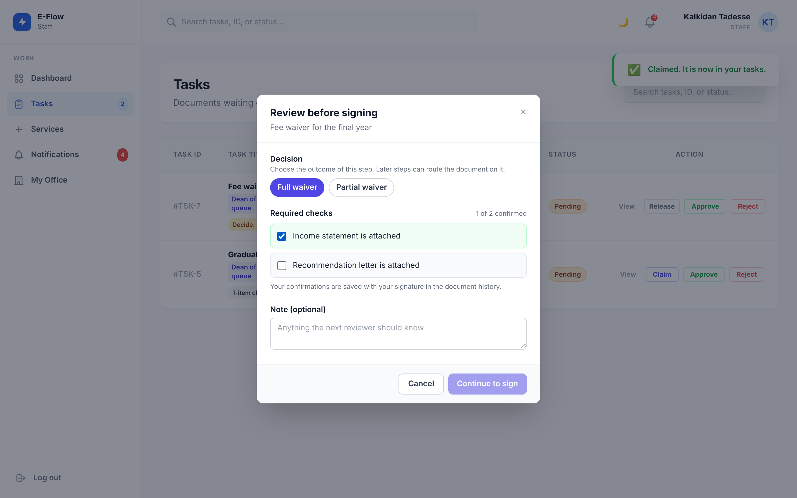
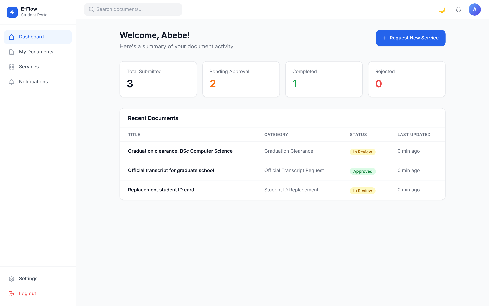
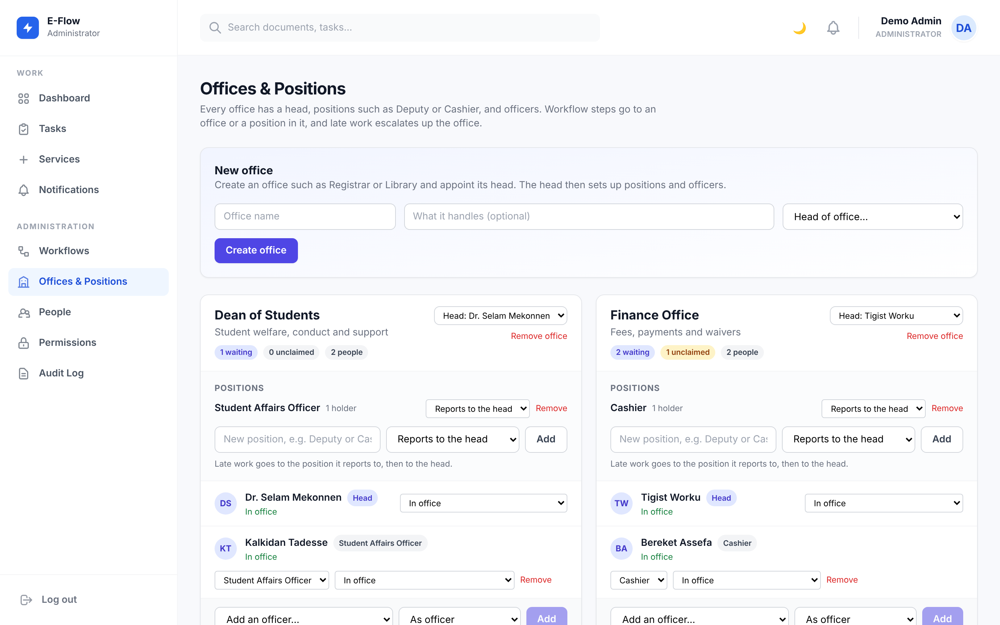
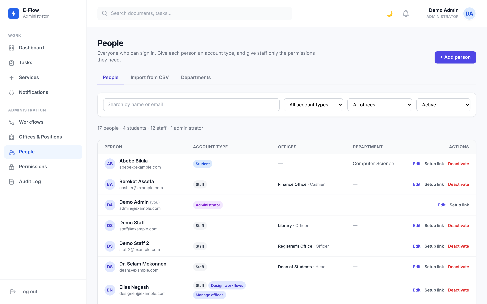
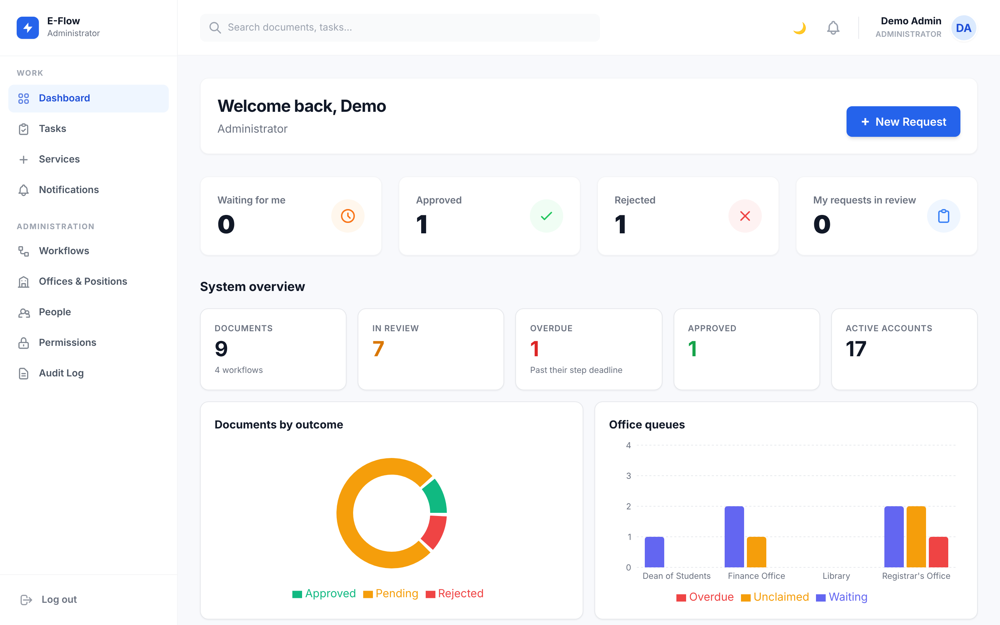
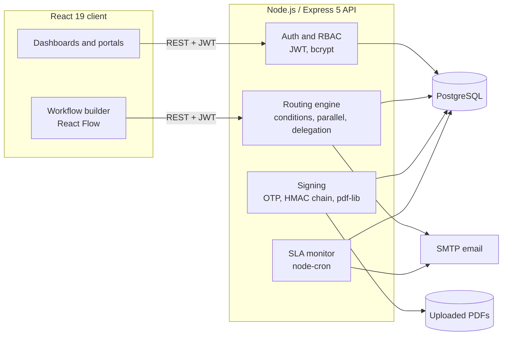

# E-Flow: Document Workflow & Approval System

E-Flow replaces paper forms in a university (or any organisation) with digital workflows. A student submits a document, such as a graduation clearance or a course withdrawal request, and E-Flow routes it through the right people. Each approver signs with a one-time code and a drawn signature, and every approval is cryptographically chained, so anyone can later check that the document was really approved and has not been tampered with.


*The full-screen builder: offices clear a student in parallel, then the Registrar signs. Each step's panel sets who reviews it, its deadline and what the reviewer must confirm before signing.*

## The problem

In many universities, simple requests like a clearance form still mean walking between offices to collect stamps and signatures, with no way to see where a request is stuck. E-Flow defines each route once, tracks every step, and lets anyone verify the final result without contacting the office that issued it.

## Features

**Office-based routing**
- The admin creates offices (Registrar, Library, Finance...) and appoints a head. Each head sets up the positions in their office (Deputy, Records Officer, Cashier...), says who each position reports to, adds officers and sets who covers for whom while someone is away. The admin isn't involved in day-to-day staffing.
- Workflow steps go to an office instead of a named person: the office's shared queue, where any officer can claim the document; one position in the office, where only its holders can claim it; or the head of the office for a sign-off. Picking a specific person or role is still available as an advanced option.
- Late work escalates up the office automatically: to the position the late step reports to (a Records Officer's work goes to the Deputy), then to the head. No escalation target has to be set on every step.

**Visual workflow builder**
- A full-screen, drag-and-drop editor built on React Flow with seven step types: approval, branch on outcome, parallel review, wait for all, send email, wait, and start other services. Steps can also be added with one click, and the service's own settings (who can submit, prerequisites, clearances) sit in one dialog.
- Each approval step has a settings panel in plain language:
  - **Who reviews:** an office's shared queue, one of its positions, or its head.
  - **Deadline:** in hours, days or weeks, with presets, an option to count working days only (weekends don't count), and a reminder and final warning before it.
  - **Before approving:** a required checklist the reviewer must tick (the server refuses an approval without it, and the confirmations are saved with the signature), and decision outcomes such as *Full waiver / Partial waiver* that the reviewer chooses while signing.
  - **Reviewer can:** approve, send back, or attach files.
- A *Branch on outcome* step routes the request by the decision made earlier; its options are picked from the outcomes defined in the workflow, not typed.
- Workflows are validated before they can be published: loops (found with a depth-first search), dangling connections, approval steps with no approver, branches with no outcome to match and parallel splits with a single branch are all reported back in the builder.
- Saving as a draft skips validation, and a workflow can't be edited in a way that removes a step a live document is waiting on.
- Besides offices, a step can go to a specific person, a role, or a role within the submitter's department (advanced options).
- Workflows can require prerequisite workflows to be completed first.

**Tamper-evident approvals**
- Each approval is signed with an HMAC that includes the previous approval's signature, forming a hash chain. Changing any past step breaks every signature after it.
- Approvers confirm with a one-time code sent by email, plus a hand-drawn signature captured on a canvas.
- A certificate page listing every approval and signature is appended to the final PDF.
- Students can create public verification links (with expiry and use limits, and the option to revoke them) that let anyone confirm a document is genuine.

**Operations**
- Per-step deadlines with reminders and final warnings. Once the deadline passes, the step escalates once, up the office or to a person chosen on the step.
- Delay steps pause a document for a set number of hours, and a background job resumes it.
- Out-of-office delegation that follows chains of delegates and detects loops.
- In-app and email notifications, version history when a document is resubmitted, and a history of the outcomes chosen at each step.
- System statistics on the dashboard (including overdue documents and each office's queue), and a searchable audit log with CSV export.

**Access control**
- JWT authentication with bcrypt-hashed passwords and expiring password-reset tokens.
- Uploaded files are not public: they are served only to signed-in users allowed to see the document, using a short-lived file token that can't call the API.
- Rate limits on sign-in, password-reset and one-time-code requests. One-time codes are stored hashed in the database and cancelled after five wrong guesses.
- Three account types: Student, Staff and Administrator. Staff can be given individual permissions (Design workflows, Manage offices, Manage people, View audit log), so nobody needs full administrator access to do one job. Changing someone's access needs a one-time code, only an Administrator can create another Administrator, and nobody can change their own access.
- A People page to search and filter every account, add people (they get a link to set their own password), import them from CSV with a row-by-row check first, and deactivate accounts. Deactivating someone hands their waiting documents to a colleague and signs them out at once.

**Layout**
- Every part of the app has its own page and address: Dashboard, Tasks, Services, Notifications and My Office for everyone who works in an office, plus Workflows (a full-screen builder), Offices & Positions, People, Permissions and Audit Log for those with the matching permission. On a phone the sidebar becomes a menu.

| Staff approval queue | Reviewing before signing |
| --- | --- |
|  |  |

| Student portal |
| --- |
|  |

| Offices and positions | People |
| --- | --- |
|  |  |

| Dashboard for administrators |
| --- |
|  |

## Architecture



**How a document moves:** when a document is submitted, the engine reads the workflow graph and finds the first step. Each approval writes a signed record and moves the document along the matching edge. Branch steps choose a path based on the outcome a reviewer chose at an earlier step. Parallel nodes create branches that run at the same time, and the merge gate waits until all of them are done. When the last step is approved, the certificate is stamped onto the PDF and any "spawn" workflows start.

## Tech stack

| Layer | Tools |
| --- | --- |
| Frontend | React 19, React Router, Tailwind CSS, React Flow, Recharts, react-signature-canvas, Axios |
| Backend | Node.js, Express 5, node-cron, Multer |
| Database | PostgreSQL (`pg`) |
| Documents | pdf-lib (stamping, certificates), pdf-parse and Tesseract.js (text extraction) |
| Security | JSON Web Tokens, bcrypt, HMAC-SHA256, email OTP via Nodemailer |

## Running it locally

**Prerequisites:** Node.js 18 or later, and PostgreSQL 14 or later.

```bash
# 1. Backend
cd server
npm install
cp .env.example .env        # then set DB_PASSWORD, JWT_SECRET and APPROVAL_SIGNING_SECRET
npm run db:setup            # creates the database, tables and the demo (see below)
npm run dev                 # API on http://localhost:5000

# 2. Frontend (in a second terminal)
cd client
npm install
npm start                   # app on http://localhost:3000
```

Email is optional for local use. Without SMTP settings, one-time codes are shown in the approval dialog and password-reset links are printed in the server console, so you can still test every flow.

`npm run db:reset` drops and recreates the database if you want a clean start.

### Demo data

`npm run db:setup` also loads a ready-to-show university, so nothing has to be set up by hand. Every account uses the password `demo1234` (change it with `DEMO_PASSWORD` in `.env`). Add `--no-demo` to skip it, or run `npm run db:demo` to add it to an existing database.

**Offices and staff**

| Office | Head | Positions and officers |
| --- | --- | --- |
| Registrar's Office | `registrar@example.com` (Hana Tesfaye) | Deputy Registrar: `deputy.registrar@example.com`; Records Officer (reports to the Deputy): `records@example.com` |
| Library | `librarian@example.com` (Yonas Kebede) | Circulation Officer: `library@example.com` |
| Finance Office | `finance@example.com` (Tigist Worku) | Cashier: `cashier@example.com` |
| Dean of Students | `dean@example.com` (Dr. Selam Mekonnen) | Student Affairs Officer: `studentaffairs@example.com` |

**Other accounts:** `admin@example.com` (Administrator), `designer@example.com` (staff who can design workflows and manage offices), and the students `abebe@example.com`, `sara@example.com`, `nahom@example.com` and `ruth@example.com`. The general test accounts `staff@example.com` and `staff2@example.com` are officers in the Library and the Registrar's Office.

**Live services**

- **Official Transcript Request:** the Cashier checks the fee, the Records Officer prepares the transcript, the Registrar signs, and the student is emailed. Each step has a checklist and a working-day deadline.
- **Graduation Clearance:** the Library, Finance and Dean of Students clear the student in parallel, then the Registrar approves.
- **Fee Waiver Application:** Student Affairs decides *Full waiver* or *Partial waiver*; a full waiver goes to the head of Finance, a partial one to the Cashier.
- **Student ID Replacement:** any Registrar officer can claim it, with a two-working-day deadline.

**Requests already in progress:** one transcript fully approved and stamped (Abebe), one waiting in the Records Officer's queue (Sara), one claimed by the Cashier (Nahom); a graduation clearance with two of three offices done (Ruth) and one just submitted; a fee waiver routed to the Cashier as a partial waiver and one waiting for a decision; an ID request sent back to the student (Ruth) and one past its deadline.

**A two-minute tour:** sign in as `records@example.com` and approve Sara's transcript from Tasks (claim it, tick the checklist, sign with the code shown on screen); then as `registrar@example.com` to sign it off; then as `studentaffairs@example.com` to decide Sara's fee waiver and watch it route by the outcome; then as `designer@example.com` to open any service in the builder. `admin@example.com` shows the system overview, People and Offices.

### Running on more than one server

Background jobs (delay timers and deadline checks) run inside the API by default. A database lock makes sure only one server runs them at a time, so several API servers never send the same reminder twice. To keep them out of the API entirely, set `RUN_BACKGROUND_JOBS=false` on the API servers and run `npm run worker` once. Behind a proxy such as Nginx or Render, set `TRUST_PROXY=1` so rate limits see each visitor's real address.

## Testing

```bash
cd server
npm test            # unit tests + integration tests (needs PostgreSQL)
npm run test:unit   # unit tests only, no database needed
```

The integration tests start the real API against a separate `eflow_test` database (created and reset automatically) and drive whole documents through it: linear, conditional and parallel routes, role-based load balancing, delegation, delays, deadline escalation, spawned workflows, clearances, required checklists and decision outcomes, working-day deadlines, the demo data loading cleanly, account types and permissions, adding, importing and deactivating people, offices and positions (claiming, cover, escalation up the office), protected file downloads, sign-in limits, and tamper detection on the signature chain. The unit tests cover the graph walker, workflow validation and the signature chain on their own.

GitHub Actions runs the full suite against PostgreSQL 16 and builds the client on every push and pull request.

## Project structure

```
client/                 React app
  src/pages/            Dashboard, student portal, profile, public verification, auth pages
  src/components/       Workflow builder, offices and positions, document details, upload
  src/components/admin/ People, permissions, audit log and system overview pages
server/
  src/index.js          Express app entry point
  src/routes/           REST endpoints (auth, documents, approvals, workflows, offices, people, admin, users, notifications)
  src/services/         Routing engine, workflow graph and validation, access rules, approval signing, notifications
  src/middleware/       JWT authentication and permission checks
  src/cron/             Background jobs: delay timers and deadline monitoring
  src/worker.js         Optional stand-alone worker for those jobs
  test/                 Unit and integration tests
  db/schema.sql         Base schema
  db/migrations/        Incremental schema changes, applied in order
  db/setup.js           One-command database setup
  db/demo.js            Demo offices, people, services and requests
docs/screenshots/       Images used in this README
```

## Challenges and what I learned

- **Modelling workflows as graphs.** Supporting conditions, parallel branches and merges meant treating each workflow as a directed graph. I had to detect cycles before publishing and track the state of each parallel branch on the document.
- **Making approvals verifiable.** Storing "approved by X" in a table isn't proof. Chaining HMAC signatures means any edit to history can be detected, and the public verification page lets people outside the system check a document.
- **Modelling who can do what.** The first version let admins invent custom user types, which mixed up two questions: what kind of account someone has, and what extra work they are trusted with. Splitting these into three fixed account types plus individual permissions, and moving everyday staffing into offices run by their heads, made the rules simpler to explain and to test.
- **Keeping the engine testable.** The routing logic is split into a pure graph walker, which decides where a document goes next, and a thin database layer that applies the decision. That made it possible to unit-test every node type, and the integration tests found real bugs (parallel branches with several steps, delays that never paused, deadlines carried over to later steps) that clicking through the app had missed.
- **Data integrity.** Multi-step updates such as approving, routing and notifying run inside database transactions, so a failure halfway through can't leave a document in an inconsistent state.

## Possible next steps

- Storing uploaded files in object storage (such as S3) instead of the server's disk
- Sending email from a queue after the database transaction, so a slow mail server never slows down approvals
- Single sign-on with the university's accounts
- Deployment with Docker
