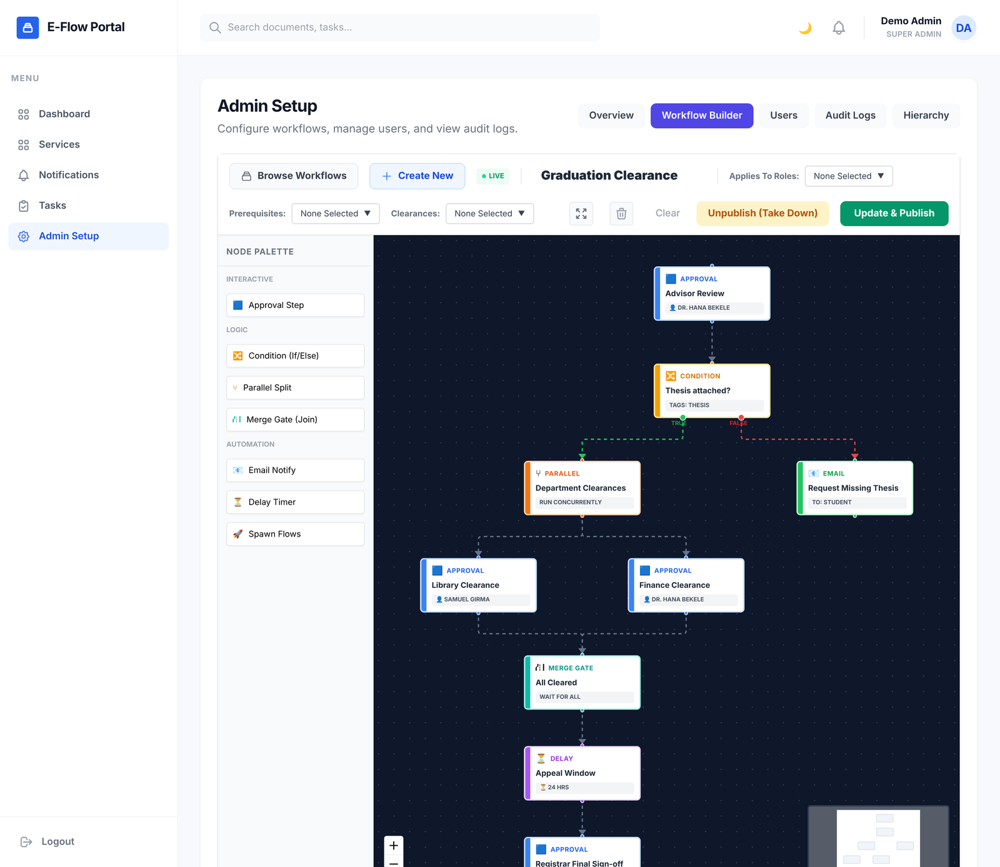
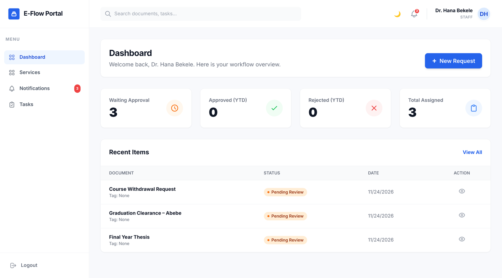
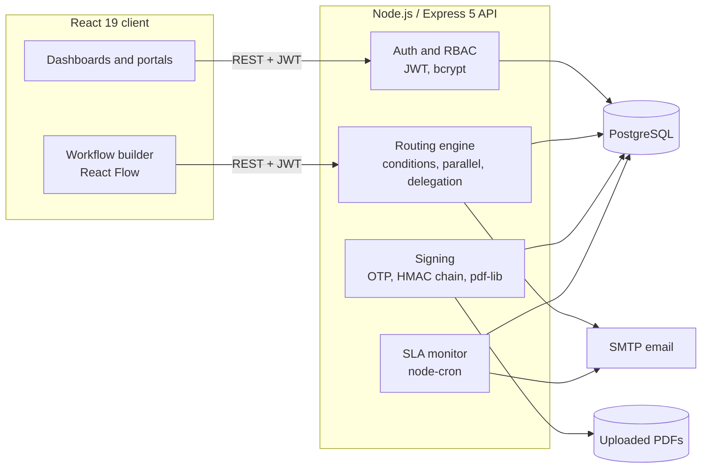

# E-Flow: Document Workflow & Approval System

E-Flow replaces paper forms in a university (or any organisation) with digital workflows. A student submits a document, such as a graduation clearance or a course withdrawal request, and E-Flow routes it through the right people. Each approver signs with a one-time code and a drawn signature, and every approval is cryptographically chained, so anyone can later check that the document was really approved and has not been tampered with.


*Admins design approval routes visually: approvals, if/else conditions, parallel branches that merge, timers, emails, and steps that start other workflows.*

## The problem

In many universities, simple requests like a clearance form still mean walking between offices to collect stamps and signatures, with no way to see where a request is stuck. E-Flow defines each route once, tracks every step, and lets anyone verify the final result without contacting the office that issued it.

## Features

**Visual workflow builder**
- Drag-and-drop editor built on React Flow with seven node types: approval, condition, parallel split, merge gate, email, delay, and spawn (start another workflow when this one finishes).
- Workflows are checked for cycles with a depth-first search before they can be published, so a broken route can't trap a document forever.
- Approvers can be a specific person, a role, or a role within the submitter's department, with per-step permissions (approve, reject, attach) and checklists.
- Workflows can require prerequisite workflows to be completed first.

**Tamper-evident approvals**
- Each approval is signed with an HMAC that includes the previous approval's signature, forming a hash chain. Changing any past step breaks every signature after it.
- Approvers confirm with a one-time code sent by email, plus a hand-drawn signature captured on a canvas.
- A certificate page listing every approval and signature is appended to the final PDF.
- Students can create public verification links (with expiry and use limits, and the option to revoke them) that let anyone confirm a document is genuine.

**Operations**
- SLA monitoring: a scheduled job sends reminders, then warnings, then escalates overdue documents.
- Out-of-office delegation that follows chains of delegates and detects loops.
- In-app and email notifications, version history when a document is resubmitted, and document tags with history.
- Admin dashboard with statistics, a full audit log with CSV export, and bulk user import from CSV with email activation links.

**Access control**
- JWT authentication with bcrypt-hashed passwords and expiring password-reset tokens.
- Built-in Student, Staff and Super Admin roles, plus custom roles that admins create with fine-grained permissions. Before a role is removed, its impact is analysed and the role is safely sealed.

| Student portal | Staff approval queue |
| --- | --- |
|  |  |

## Architecture



**How a document moves:** when a document is submitted, the engine reads the workflow graph and finds the first step. Each approval writes a signed record and moves the document along the matching edge. Condition nodes choose a branch based on the document's tags. Parallel nodes create branches that run at the same time, and the merge gate waits until all of them are done. When the last step is approved, the certificate is stamped onto the PDF and any "spawn" workflows start.

## Tech stack

| Layer | Tools |
| --- | --- |
| Frontend | React 19, React Router, Tailwind CSS, React Flow, Recharts, react-signature-canvas, Axios |
| Backend | Node.js, Express 5, node-cron, Multer |
| Database | PostgreSQL (`pg`) |
| Documents | pdf-lib (stamping, certificates), pdf-parse and Tesseract.js (text extraction) |
| Security | JSON Web Tokens, bcrypt, HMAC-SHA256, email OTP via Nodemailer |

## Running it locally

**Prerequisites:** Node.js 18 or later, and PostgreSQL 14 or later.

```bash
# 1. Backend
cd server
npm install
cp .env.example .env        # then set DB_PASSWORD, JWT_SECRET and APPROVAL_SIGNING_SECRET
npm run db:setup            # creates the database, tables and demo accounts
npm run dev                 # API on http://localhost:5000

# 2. Frontend (in a second terminal)
cd client
npm install
npm start                   # app on http://localhost:3000
```

Email is optional for local use. Without SMTP settings, one-time codes and password-reset links are printed in the server console, so you can still test every flow.

`npm run db:reset` drops and recreates the database if you want a clean start.

### Demo accounts

`npm run db:setup` creates these accounts for local testing. The password for all of them is `demo1234`, which you can change with `DEMO_PASSWORD` in `.env`.

| Role | Email |
| --- | --- |
| Super Admin | `admin@example.com` |
| Staff | `staff@example.com` |
| Staff | `staff2@example.com` |
| Student | `abebe@example.com` |

## Project structure

```
client/                 React app
  src/pages/            Dashboard, student portal, profile, public verification, auth pages
  src/components/       Workflow builder, document details, role manager, upload
server/
  src/index.js          Express app entry point
  src/routes/           REST endpoints (auth, documents, approvals, workflows, admin, users, notifications)
  src/middleware/       JWT authentication and permission checks
  src/cron/             SLA monitor
  db/schema.sql         Base schema
  db/migrations/        Incremental schema changes, applied in order
  db/setup.js           One-command database setup
docs/screenshots/       Images used in this README
```

## Challenges and what I learned

- **Modelling workflows as graphs.** Supporting conditions, parallel branches and merges meant treating each workflow as a directed graph. I had to detect cycles before publishing and track the state of each parallel branch on the document.
- **Making approvals verifiable.** Storing "approved by X" in a table isn't proof. Chaining HMAC signatures means any edit to history can be detected, and the public verification page lets people outside the system check a document.
- **Changing roles safely.** Deleting a role that live workflows depend on can strand documents. I added impact analysis and "sealing", which disables a role without breaking references to it.
- **Data integrity.** Multi-step updates such as approving, routing and notifying run inside database transactions, so a failure halfway through can't leave a document in an inconsistent state.

## Possible next steps

- Automated tests for the routing engine and the signature chain
- Serving uploaded files through an authenticated endpoint
- Deployment with Docker
